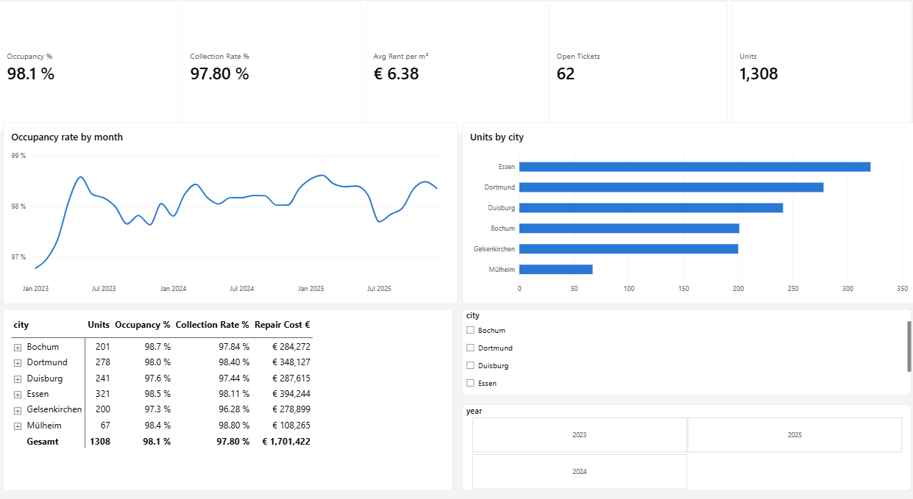
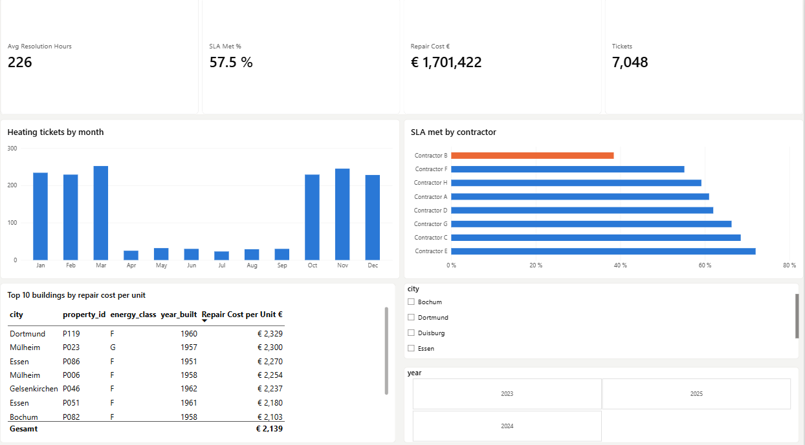
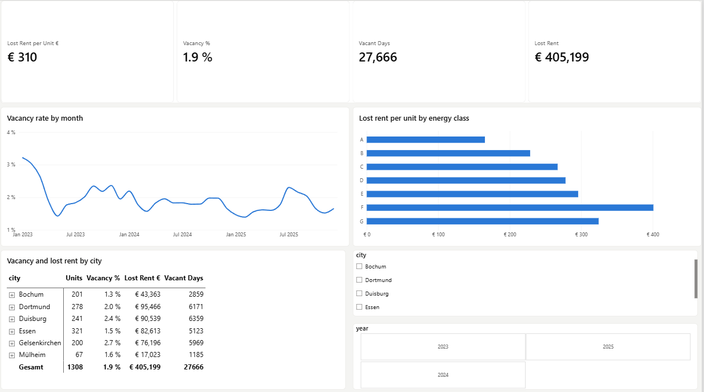
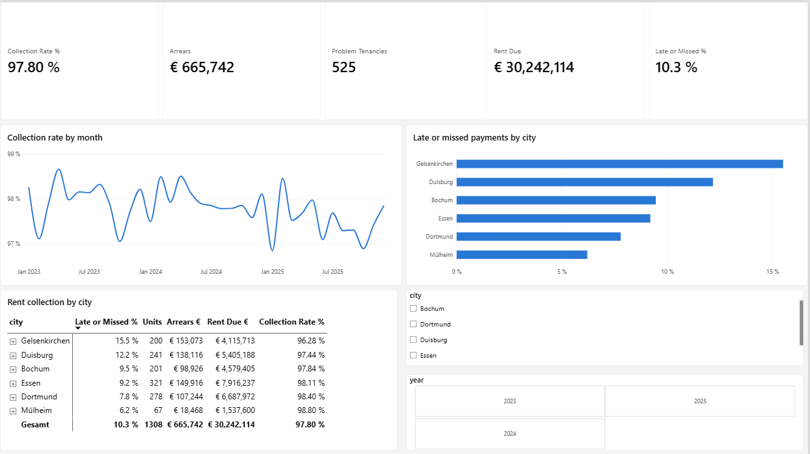
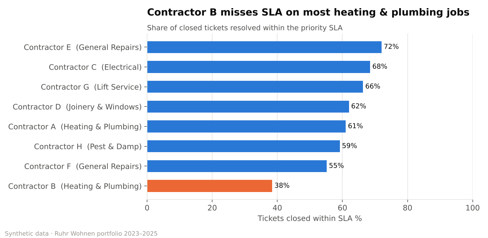

# Ruhr Property Analytics — Residential Portfolio Dashboard

**End-to-end data analytics project: Python · SQL · Power BI**

A housing company managing **1,308 flats in 120 buildings** across Essen, Bochum, Dortmund, Duisburg, Gelsenkirchen and Mülheim wants to know where it is losing money: through vacancy, unpaid rent, or repairs — and what to do about it.

I built the full pipeline: messy system exports → cleaning and validation in Python → a star-schema database queried with SQL → an interactive Power BI dashboard with findings management can act on.

> **Why this project:** I worked for over six years in residential property and facility management in the Ruhr area, planning and carrying out work across 120+ properties a week. This project answers the questions I saw property managers ask every day — with data.

---

## Dashboard

<!-- Replace these with your own screenshots after building the report (see powerbi/BUILD_GUIDE.md, step 9) -->
| Portfolio Overview | Maintenance & Contractors |
|---|---|
|  |  |
| **Vacancy & Energy** | **Rent Collection** |
|  |  |

📄 [Dashboard as PDF](docs/Ruhr_Property_Dashboard.pdf) · 📊 [Power BI file](powerbi/Ruhr_Property_Dashboard.pbix)

---

## Key findings

| # | Finding | Recommendation |
|---|---|---|
| 1 | **89%** of heating tickets arrive between October and March | Book contractor capacity and boiler servicing in September |
| 2 | Pre-1970 buildings generate **226 tickets per 100 units a year** vs **86** for buildings from 2005+ | Move the top-cost buildings from reactive repairs to planned modernisation |
| 3 | Contractor B meets the SLA on only **38%** of heating & plumbing jobs vs **61%** for Contractor A (270 vs 188 hours on average) | Review the service agreement; route urgent heating work to Contractor A |
| 4 | **15.5%** of rent payments in Gelsenkirchen are late, partial or missed vs **6.2%** in Mülheim | Contact tenants after the first missed payment; offer instalment plans |
| 5 | Units in energy classes F–G lost **€373** each to vacancy vs **€165** for class A — **€154,885** in total | Include lost rent in the business case for energy upgrades |

Headline KPIs: occupancy **98.1%** · rent collection **97.80%** · arrears **€665,742** · repair spend **€1.70m** · tickets closed within SLA **57.5%**.

Full write-up with charts: [`outputs/insights.md`](outputs/insights.md)



---

## What I did

**1. Data cleaning & validation (Python, pandas)** — [`python/02_clean_and_validate.py`](python/02_clean_and_validate.py)
The raw exports contain the problems real property systems have. Each one is detected, fixed and logged in the [data quality report](outputs/data_quality_report.md):
- 84 duplicate tickets from a system re-export
- 493 dates typed in German format (`dd.mm.yyyy`) mixed with ISO dates
- 14 inconsistent city names (`ESSEN`, `GE`, `Muelheim` …)
- 63 inconsistent category labels
- 25 tickets closed *before* they were opened → excluded from resolution-time KPIs
- 158 closed tickets without a cost → **left blank, not guessed**, so totals stay honest

**2. Data modelling** — a star schema with 4 dimension and 4 fact tables, including a unit × month occupancy table that makes vacancy and lost-rent analysis simple and fast.

**3. SQL analysis** — [`sql/02_analysis_queries.sql`](sql/02_analysis_queries.sql)
Ten business questions using joins, CTEs, `CASE`, `HAVING` and window functions (`RANK() OVER`). Results are saved in [`outputs/sql_results/`](outputs/sql_results/).

**4. Power BI dashboard** — four pages with 25+ DAX measures (collection rate, SLA %, normalised ticket rates, year-over-year), synced slicers, drill-through to property level and report-page tooltips. Measures: [`powerbi/DAX_measures.md`](powerbi/DAX_measures.md)

---

## Data model

```
dim_property ──1:*── dim_unit ──1:*──┬── fact_unit_month
                                     ├── fact_rent_payment
                                     ├── fact_tenancy
                                     └── fact_ticket ──*:1── dim_contractor

dim_date ──1:*── fact_unit_month[month], fact_rent_payment[month], fact_ticket[created_date]
```

| Table | Grain | Key columns |
|---|---|---|
| dim_property | one building | city, district, year_built, energy_class, has_elevator |
| dim_unit | one flat | property_id, floor, rooms, size_sqm |
| dim_contractor | one contractor | trade |
| dim_date | one day | year, quarter, month, is_heating_season |
| fact_tenancy | one tenancy | start/end date, monthly_rent_eur (Nettokaltmiete) |
| fact_rent_payment | tenancy × month | amount due/paid, days_late, arrears_eur, payment_status |
| fact_ticket | one repair ticket | category, priority, contractor, resolution_hours, sla_met, repair_cost_eur |
| fact_unit_month | unit × month | occupied_days, vacant_days, lost_rent_eur |

---

## Repository structure

```
ruhr-property-analytics/
├── data/
│   ├── raw/          # messy exports (input)
│   └── clean/        # star schema CSVs (Power BI source)
├── python/
│   ├── 01_generate_data.py
│   ├── 02_clean_and_validate.py
│   ├── 03_run_sql.py
│   └── 04_eda_insights.py
├── sql/
│   ├── 01_create_tables.sql
│   └── 02_analysis_queries.sql
├── powerbi/
│   ├── BUILD_GUIDE.md
│   ├── DAX_measures.md
│   └── ruhr_theme.json
├── outputs/
│   ├── charts/
│   ├── sql_results/
│   ├── data_quality_report.md
│   └── insights.md
└── docs/             # dashboard screenshots and PDF
```

## How to run it

```bash
pip install -r requirements.txt
python python/01_generate_data.py      # create raw data
python python/02_clean_and_validate.py # clean + build star schema
python python/03_run_sql.py            # load SQLite + run SQL queries
python python/04_eda_insights.py       # charts + insights
```
Then open Power BI and follow [`powerbi/BUILD_GUIDE.md`](powerbi/BUILD_GUIDE.md).

## About the data

The dataset is **synthetic**: generated in Python to mirror how a German residential landlord's systems look (properties, tenancies, monthly rent, repair tickets, contractors), using typical Ruhr-area ranges for rent levels, building age and energy classes. Company, contractor and tenant records are fictional. Patterns such as seasonal heating demand and higher repair rates in older buildings are built in deliberately so the analysis has real questions to answer. Using synthetic data keeps real tenant data private while allowing a realistic end-to-end project.

---

**Emmanuel Ogochukwu Okatta** — Junior Data Analyst · Essen, Germany · English (fluent), German (B1)
[LinkedIn](https://www.linkedin.com/in/emmanuel-ogochukwu-okatta)
