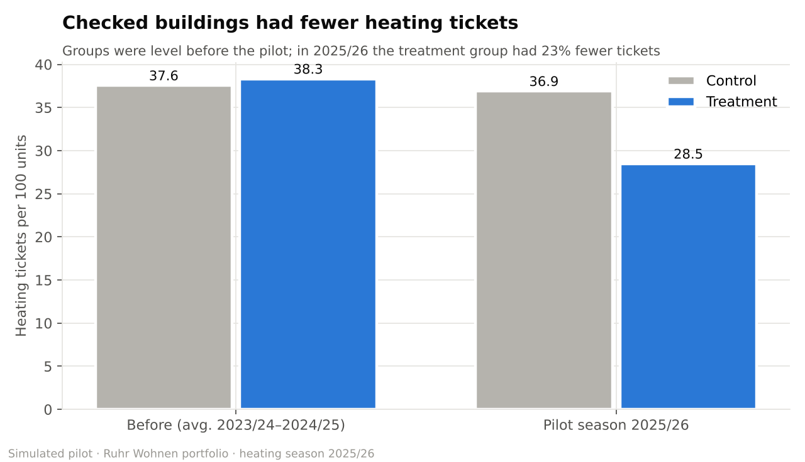
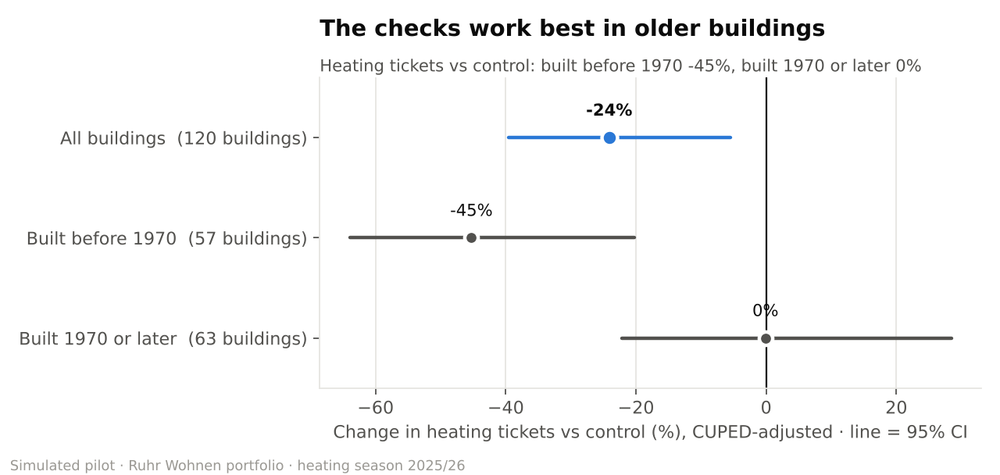

# A/B test readout: preventive heating checks

**Decision: Roll out preventive checks to buildings built before 1970; keep testing the rest.**

- In buildings built **before 1970**, the check cut heating tickets by **45%**
  (95% CI -64.0% to -20.3%, p = 0.047). The repair saving of
  **€777 per building** is well above the €250 check cost.
- Across **all buildings** the effect is -24.1% (95% CI -39.6% to
  -5.5%, p = 0.051): borderline — likely real, but not proven at the 5% level.
- In buildings built **1970 or later** the effect is -0.1% and not statistically significant;
  the saving (€105 per building) does not cover the check.

> Data is simulated (see `python/05_generate_experiment.py`). The pre-period uses the
> project's ticket data; the pilot season is generated with a planted effect so the
> method can be checked against a known answer.

## 1. Design (fixed before the analysis)

| Item | Choice |
|---|---|
| Hypothesis | A preventive heating check in September reduces heating tickets in the following heating season |
| Second hypothesis | The effect is larger in buildings built before 1970 (older boilers; finding #2 of the main project) |
| Unit of randomisation | Building (all flats in a building share one heating system) |
| Randomisation | Stratified by building age band, 50/50 |
| Primary metric | Heating tickets per 100 units, 1 Oct 2025 – 31 Mar 2026 |
| Secondary metrics | Emergency heating tickets per 100 units; heating repair cost per unit |
| Significance | α = 0.05, two-sided; power 80% |
| Minimum detectable effect | 20% relative (7.6 tickets per 100 units on a baseline of 37.9) |

With only 120 buildings, the test can only reliably detect a large effect (about
20%). A result that is not significant therefore means "not proven", not
"no effect".

## 2. Sanity checks

| Check | Result |
|---|---|
| Sample ratio | 59 treatment / 61 control buildings, χ² p = 0.86 → no mismatch |
| Units | 625 treatment / 683 control |
| Pre-period tickets per 100 units | treatment 38.3 vs control 37.6 (+2.0%) → groups comparable |

## 3. Primary result

| Method | Effect | 95% CI | p-value |
|---|---|---|---|
| Difference in rates (permutation test + stratified bootstrap) | -22.8% | -39.3% to -2.2% | 0.080 |
| CUPED (adjusted for each building's ticket history) | -24.1% | -39.6% to -5.5% | 0.051 |
| Check: Welch t-test on building rates | | | 0.021 |

Control: **36.9** heating tickets per 100 units · Treatment: **28.5**.

**Why CUPED:** some buildings always have more heating faults than others. Adjusting for
each building's ticket history removes part of that known noise (correlation between
history and pilot season: 0.46), so the confidence interval is 8%
narrower with the same data.

**Why building-level inference:** flats in the same building share a boiler, so their tickets
are not independent. Bootstrapping and permuting whole buildings keeps the uncertainty
honest; treating each flat as independent would make the result look more certain than it is.

**Why the bootstrap interval and the p-value disagree slightly:** they are two different
approximations. When they sit on either side of the line, the honest reading is "borderline".

## 4. Secondary metrics

| Metric | Control | Treatment | Change | p-value |
|---|---|---|---|---|
| Emergency heating tickets per 100 units | 8.5 | 2.7 | -68.0% | 0.032 |
| Heating repair cost per unit | €120.45 | €83.43 | -30.7% (CI -48.1% to -7.0%) | 0.060 |

## 5. Older vs newer buildings, and the business case

| Segment | Buildings | Control per 100 units | Treatment per 100 units | Effect [95% CI] | p-value | Repair saving per building | Net after €250 check |
|---|---|---|---|---|---|---|---|
| All buildings | 120 | 36.9 | 28.5 | -24.1% [-39.6%, -5.5%] | 0.051 | €404 | €154 |
| Built before 1970 | 57 | 47.7 | 29.2 | -45.3% [-64.0%, -20.3%] | 0.047 | €777 | €527 |
| Built 1970 or later | 63 | 28.5 | 27.7 | -0.1% [-22.1%, +28.4%] | 0.994 | €105 | −€145 |

## 6. Recommendation

1. **Book preventive checks for all buildings built before 1970** before the 2026/27 heating
   season. Expected net saving: about €527 per building, or
   €30,018 across 57 buildings.
2. **Keep testing newer buildings**: leave them in a pilot for another season rather than
   paying for checks that the data does not yet justify.
3. **Keep a small control group** (about 10% of older buildings) in 2026/27 to confirm the
   effect holds when the checks are rolled out at scale.

**Not counted in the business case:** fewer night-time emergency call-outs, fewer tenant
complaints, and fewer rent reductions for missing heating. These would make the case stronger.

**Assumption to check:** the check costs €250 per building. Get a real quote
from the contractors before rolling out.
