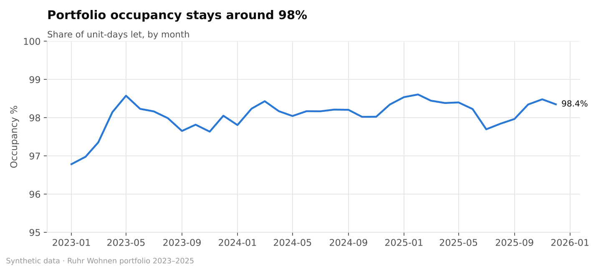
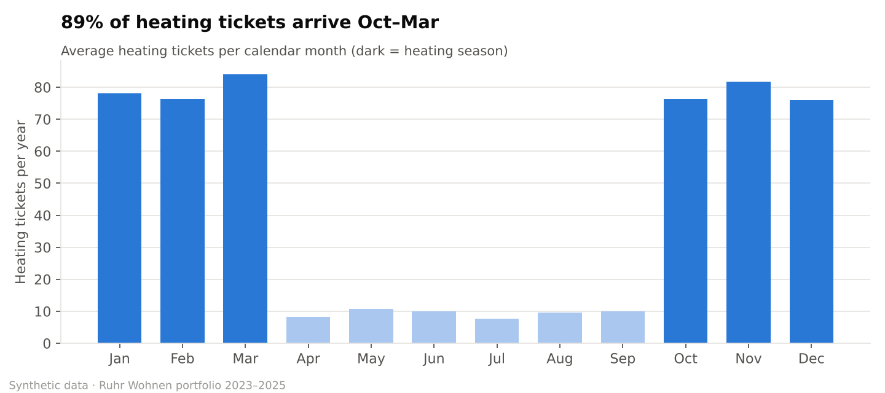
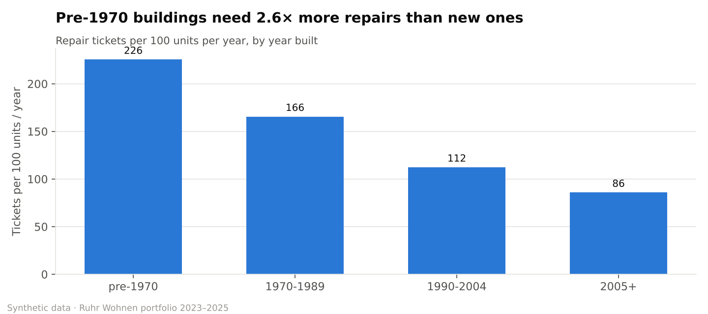
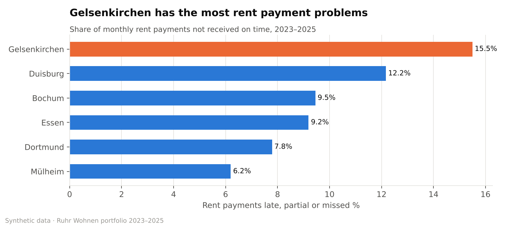
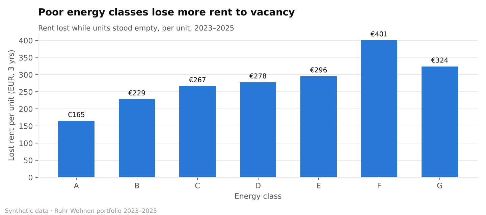

# Key Findings — Ruhr Wohnen Portfolio (2023–2025)

*All figures are calculated by `python/04_eda_insights.py` from the cleaned data. The dataset is synthetic.*

## Headline KPIs

| KPI | Value |
|---|---:|
| Properties / units | 120 / 1,308 |
| Average occupancy | 98.1% |
| Rent lost to vacancy | €405,199 |
| Rent collection rate | 97.80% |
| Unpaid rent (arrears) | €665,742 |
| Repair tickets | 7,048 |
| Repair spend (recorded) | €1,701,422 |
| Tickets closed within SLA | 57.5% |
| Average rent, current tenants | €6.38 per m² |

## Findings and recommendations

1. **Heating demand is seasonal and predictable.** 89% of heating tickets arrive between October and March.
   → *Book contractor capacity and boiler servicing in September, before the peak.*

2. **Old buildings drive the repair workload.** Pre-1970 buildings generate 226 tickets per 100 units a year, versus 86 in buildings from 2005 onwards.
   → *Prioritise the highest cost-per-unit properties (SQL query Q8) for planned modernisation instead of repeated reactive repairs.*

3. **One contractor is a clear bottleneck.** Contractor B (Heating & Plumbing) closes only 38% of tickets within SLA, against 61% for Contractor A in the same trade (average 270 vs 188 hours).
   → *Review the service agreement and shift urgent heating work to the faster contractor.*

4. **Payment problems concentrate in one city.** In Gelsenkirchen, 15.5% of monthly payments are late, partial or missed (collection rate 96.28%), against 6.2% in Mülheim. Across the portfolio, 10% of tenancies account for 43% of all unpaid rent (see SQL query Q9).
   → *Start early-contact reminders after the first missed payment and offer instalment plans.*

5. **Energy efficiency affects income, not just costs.** Units in energy classes F–G lost €373 each to vacancy over three years, versus €165 for class A — €154,885 in total.
   → *Include vacancy loss in the business case for energy upgrades.*

## Charts

